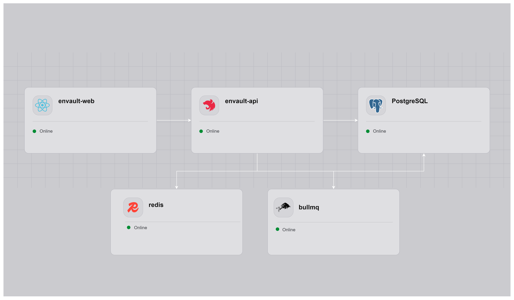
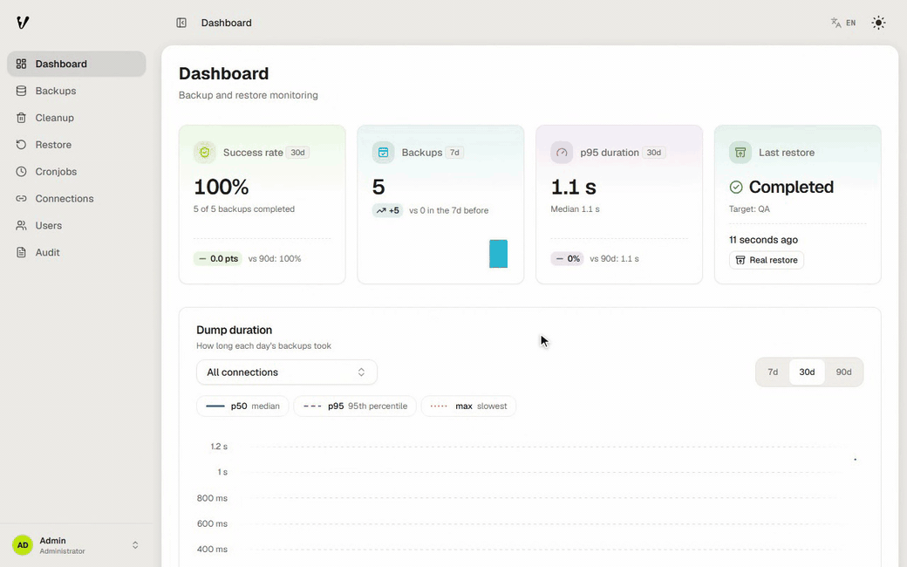

# EnVault Management

> 🇪🇸 Versión en español: [README.es.md](README.es.md)

**Real production data in dev and QA, without overwriting the wrong database.**

Scheduled backups to your own Cloudflare R2 bucket, a dry run before you restore, and production blocked as a restore target.

EnVault is a self-hosted, [Fair Source](#license) web app for PostgreSQL and MySQL. It backs up your production databases to Cloudflare R2 and restores those dumps into your development and QA databases. Connections labeled PROD can be backed up but are refused as restore targets.





---

## Why EnVault

Loading real data into dev and QA should be routine. On low-cost hosting it often isn't:

- **Platform backups stay inside the platform.** On Railway, for example, volume backups need the Pro plan and [can only be restored into the same project and environment](https://docs.railway.com/volumes/backups), so they can't seed a dev database from production.
- **Point-in-time recovery is expensive.** Supabase's [PITR add-on](https://supabase.com/docs/guides/platform/backups) starts at about $100 per month on top of the Pro plan.
- **Accidents happen.** A dump loaded over the wrong database, or a database deleted by mistake, is easy to cause with hand-run `pg_restore` or `mysql` commands.

EnVault gives you one place to take production dumps on a schedule and load them into dev and QA, with guardrails around production.

> Prices and plan limits were checked in October 2026. Check each provider's page for current terms.

---

## What it does today

### Back up production

- Register PostgreSQL and MySQL connections and label each one **PROD**, **QA** or **DEV**. Test a connection before you save it.
- Back up PROD connections on demand or on a schedule: every 1, 2, 3, 4, 6, 8 or 12 hours, daily, weekly or monthly. Only PROD connections can be backed up.
- Dumps (`pg_dump` custom format or `mysqldump`) stream straight into a private Cloudflare R2 bucket in 32 MB multipart chunks, without being written to the server's disk first.
- The API image ships the PostgreSQL client tools for versions 14 to 18 and uses the one that matches each server.
- Each dump records a SHA-256 digest in its R2 manifest and in its job record.
- Follow progress live, cancel a running job, and download a dump through a link that expires after 15 minutes.

### Refresh dev and QA

- Restore any dump into a QA or DEV connection of the same engine.
- Run an optional dry run first. It compares the dump's tables and estimated row counts with the target's, without changing anything.
- Before the target is touched, EnVault:
  - downloads the dump to a staging area, checking free disk space first;
  - compares the dump's SHA-256 with the recorded digest, when one is available;
  - refuses restores that can't work, such as a PostgreSQL 17 dump into a PostgreSQL 16 server.
- PostgreSQL restores run as one transaction (`pg_restore --single-transaction`) after a structural check (`pg_restore -l`).
- MySQL restores load into a shadow database first, then swap the tables in with one `RENAME TABLE`. Views, triggers, routines and events are recreated right after the swap, so they are missing for a brief moment. If the swap fails, the previous tables are put back.
- Only one restore runs per target at a time.

### Keep storage under control

- Set retention rules per connection: keep the last N dumps, delete dumps older than N days, or cap total size. The newest dump is always kept, and a dump used by a running restore is never deleted.
- Preview every cleanup before it runs: which dumps, why, and how much space it frees.
- A cleanup deletes the dump and its manifest from R2 first, and removes the database record only after both are gone.
- Reconcile R2 with the database to find records whose dump is missing and files with no record.
- See storage use per connection and category.

### See what happened

- A dashboard with daily backup activity, success rate, durations, connection health, storage per connection and restore status.
- An append-only audit log of mutating API requests (successful or failed) and of sign-ins, sign-outs and password changes.
- User management for admins, and a web UI in English and Spanish.

---

## Who it's for

- **Developers and freelancers** who run several apps on low-cost hosting, such as Railway or a VPS, and want realistic data in dev and QA.
- **Small agencies** that want one place to see every client's backups and restores.
- **Teams** whose platform backups can't restore production into a different environment.

> Companies, freelancers and agencies can use EnVault, including for client work. Offering it as a competing commercial product or service, such as a hosted SaaS, needs permission. See [License](#license).

---

## When to use something else

EnVault focuses on one job: moving production data into dev and QA safely. It takes logical dumps (`pg_dump`, `mysqldump`) and does not do point-in-time recovery.

| If you need | Consider |
| ----------- | -------- |
| Backups only, with no refresh of dev or QA | Your platform's native backups, or a general backup tool such as [Databasus](https://github.com/databasus/databasus) |
| Point-in-time recovery or physical backups | [pgBackRest](https://pgbackrest.org) or [WAL-G](https://github.com/wal-g/wal-g) |

---

## Cost example

The author runs EnVault for about **$5 per month**:

| Item | Setup |
| ---- | ----- |
| Hosting | Railway Hobby plan: $5 per month, with $5 of usage included |
| Storage | Cloudflare R2 free tier: 10 GB-month of storage, 1 million Class A operations per month, free egress |
| Workload | 2 production databases, 48 dumps per day in total |

This is one real setup, not a guarantee. Your cost depends on database size, dump frequency, retention and the providers' current prices.

---

## Quick start

### Requirements

- **To run it:** Docker and Docker Compose, a Cloudflare R2 bucket, and an R2 API token.
- **To develop it:** Node.js 22 (22.23.4 or later) and pnpm 10.
- **Control database** (EnVault's own state: connections, audit log, schedules, dump metadata): PostgreSQL 16 or later. Other engines are not supported, and the [TypeORM configuration](apps/api/src/config/database.config.ts) is PostgreSQL-only. The Compose stack provides it, along with Redis 7.
- **Databases you back up:** PostgreSQL or MySQL. See [connecting to cloud databases](docs/en/connecting-cloud-databases.md) and [connecting to on-premise databases](docs/en/connecting-on-premise-databases.md).

### Configure

```bash
git clone https://github.com/Aisaac2205/envault
cd envault
cp .env.example .env
```

Fill in every `<placeholder>` in `.env`: R2 credentials, `ENCRYPTION_KEY` (`openssl rand -hex 32`), `DB_PASSWORD`, `BETTER_AUTH_SECRET` and the first admin's `BETTER_AUTH_ADMIN_EMAIL` and `BETTER_AUTH_ADMIN_PASSWORD`. Leave `VITE_API_URL` unset unless the web app and the API run on different origins. See [environment variables](docs/en/environment-variables.md) for the full reference.

### Run everything in Docker

```bash
docker compose up --build      # same as: pnpm docker:prod
```

Open `http://localhost:5173` and sign in with the admin email and password from `.env`.

### Run it natively for development

Set the host of `DATABASE_URL` to `localhost` in `.env`, then:

```bash
pnpm install
docker compose -f docker-compose.yml -f docker-compose.dev.yml up -d db redis   # control DB + Redis
pnpm dev                                                                         # API :3000, web :5173
```

For hot reload inside containers, use `pnpm docker:dev`, or `pnpm docker:dev:test` to also start test databases (PostgreSQL on `:5434`, MySQL on `:3306`). Details in [local development](docs/en/local-development.md).

### Deploy

| Path | Best for | Guide |
| ---- | -------- | ----- |
| PaaS (Railway walkthrough) | A working cloud stack in under an hour | [deployment-railway.md](docs/en/deployment-railway.md) |
| Self-host (Docker Compose, Kubernetes, Nomad, a VPS) | On-premise, regulated or private networks | [deployment-self-host.md](docs/en/deployment-self-host.md) |

---

## Security at a glance

- **PROD connections are locked.** They can't be edited through the API, and no connection can be reclassified to or from PROD. Deleting one requires its exact name plus the admin's current password; after 5 wrong passwords in 15 minutes, further attempts are refused for a while. A delete only removes EnVault's record and never touches the database itself.
- **PROD is refused as a restore target** when the restore is requested, when it is admitted to the queue, and again by the worker right before it writes.
- **EnVault trusts the label.** A DEV or QA connection that points at the same server and database as a PROD one is not detected yet. A physical-target check is on the [roadmap](#roadmap).
- **Dump integrity is checked when possible.** Each dump's SHA-256 is compared on restore. If neither the job record nor the manifest holds a digest, the restore currently runs without that comparison.
- **Credentials are encrypted at rest** with AES-256-GCM and never returned by the API.
- **Access is deny-by-default.** Cookie sessions (`httpOnly`) are checked against the database on every request, and a single permission map enforced by the API decides who may use what. New passwords need at least 12 characters and are refused when common or trivial.
- **The audit log is append-only.** Database triggers block `UPDATE`, `DELETE` and `TRUNCATE` on it. Admin user-management actions and scheduled runs are not in it yet; scheduled runs are traced in the job history.
- **Dumps stay private.** The bucket is private, and downloads use presigned links that expire after 15 minutes.

Full details, with code references: [security model](docs/en/security-model.md).

---

## Roadmap

- **Safer restores:** a check that a restore target is not physically the PROD database, projects to group connections, a mandatory dry run, a snapshot of the target before each restore with undo, scheduled restore drills, and refusing a restore when no digest is available.
- **Account settings** with two-factor authentication and passkeys.
- **MariaDB** support.
- **Encrypted dumps.**
- **Account recovery** by email.
- **Better environment visibility**, so it's always clear which environment you are working in.

---

## For contributors

### Stack

| Layer           | Technology                                 | Version  |
| --------------- | ------------------------------------------ | -------- |
| Runtime         | Node.js                                    | 22 (≥ 22.23.4) |
| Package manager | pnpm workspaces                            | ≥ 10     |
| Language        | TypeScript                                 | ^5.9.3   |
| Backend         | NestJS                                     | ^11.2.8  |
| ORM             | TypeORM                                    | ^0.3.31  |
| Frontend        | React                                      | ^19.3.1  |
| Build tool      | Vite                                       | ^7.3.7   |
| Router          | React Router                               | ^7.18.4  |
| Auth            | Better Auth (inside the API, cookie sessions) | 1.7.14 |
| Storage         | Cloudflare R2 (S3-compatible)              | -        |
| Control DB      | PostgreSQL 16+ (required)                  | -        |
| Queues and jobs | Redis 7 + BullMQ                           | ^6.3.16  |
| Real-time       | Server-Sent Events (SSE)                   | -        |

### Monorepo layout

```
envault/
├── apps/
│   ├── api/                   # NestJS, modular monolith        :3000
│   ├── web/                   # React + Vite, vertical slices   :5173 (dev) / :80 (container)
│   └── landing/               # Marketing site (proprietary, see License)
├── e2e/                       # Playwright end-to-end suite
├── scripts/                   # Restore drill and security check scripts
├── docs/
│   ├── assets/                # Images used by the docs
│   ├── en/                    # Technical documentation (English)
│   └── es/                    # Technical documentation (Spanish)
├── docker-compose.yml         # Production-like stack
├── docker-compose.dev.yml     # Dev overrides (hot reload, optional 'test' profile)
├── docker-compose.e2e.yml     # E2E stack overrides
├── .env.example               # Template: copy to .env (never commit .env)
├── pnpm-workspace.yaml
├── tsconfig.base.json
└── package.json
```

The monorepo uses **pnpm workspaces** without Turborepo or Nx. Workspaces: `apps/*` and `e2e`.

### Scripts

| Command                | Description                                         |
| ---------------------- | --------------------------------------------------- |
| `pnpm dev`             | API + web in watch/hot-reload mode (native Node.js) |
| `pnpm build`           | Builds every app for production                     |
| `pnpm test`            | Runs every workspace's unit tests                   |
| `pnpm test:coverage`   | Unit tests with coverage                            |
| `pnpm test:e2e`        | Playwright end-to-end suite                         |
| `pnpm lint`            | Lints every workspace                               |
| `pnpm typecheck`       | Type-checks without emitting files                  |
| `pnpm docker:dev`      | Full stack in Docker with hot reload                |
| `pnpm docker:dev:test` | Same, plus test DBs (PostgreSQL :5434, MySQL :3306) |
| `pnpm docker:db`       | Control DB only (PostgreSQL, without Redis)         |
| `pnpm docker:db:test`  | Control DB plus the test DBs                        |
| `pnpm docker:prod`     | End-to-end production build                         |

Per workspace:

```bash
pnpm --filter @vaultly-control/api dev
pnpm --filter @vaultly-control/web build
```

### Quick links for DevOps

| What you need                                       | Where to look                                                                            |
| --------------------------------------------------- | ---------------------------------------------------------------------------------------- |
| Run locally from scratch                            | [docs/en/local-development.md](docs/en/local-development.md)                             |
| Deploy to Railway (fast PaaS path)                  | [docs/en/deployment-railway.md](docs/en/deployment-railway.md)                           |
| Deploy to your own infra (K8s, Nomad, Docker, etc.) | [docs/en/deployment-self-host.md](docs/en/deployment-self-host.md)                       |
| Connect to managed cloud DBs (Neon / RDS / Azure)   | [docs/en/connecting-cloud-databases.md](docs/en/connecting-cloud-databases.md)           |
| Connect to on-premise DBs (SSH tunnels, VPN)        | [docs/en/connecting-on-premise-databases.md](docs/en/connecting-on-premise-databases.md) |
| Day-to-day operations / runbook                     | [docs/en/devops-runbook.md](docs/en/devops-runbook.md)                                   |
| Rebuild after a disaster                            | [docs/en/disaster-recovery.md](docs/en/disaster-recovery.md)                             |
| Troubleshooting                                     | [docs/en/troubleshooting.md](docs/en/troubleshooting.md)                                 |
| Where the project is headed (driver+transport)      | [docs/en/architecture-roadmap.md](docs/en/architecture-roadmap.md)                       |

> Docs marked `STATUS: PROPOSED` describe target architecture, not current behavior. Cross-check with the source before you act on them.

### Documentation

#### Getting started

| Doc                                                        | Content                                                  |
| ---------------------------------------------------------- | -------------------------------------------------------- |
| [local-development.md](docs/en/local-development.md)       | Local setup: Node.js vs Docker, commands, debugging      |
| [deployment-railway.md](docs/en/deployment-railway.md)     | Railway walkthrough: services, variables, env setup      |
| [deployment-self-host.md](docs/en/deployment-self-host.md) | Platform-agnostic deployment contract for K8s/Nomad/etc. |

#### How it works (domain)

| Doc                                                                | Content                                                      |
| ------------------------------------------------------------------ | ------------------------------------------------------------ |
| [flow-database-management.md](docs/en/flow-database-management.md) | Connections: environments, per-engine permissions, lifecycle |
| [scheduler-architecture.md](docs/en/scheduler-architecture.md)     | Cronjobs, SchedulerRegistry, single-replica trade-off        |
| [security-model.md](docs/en/security-model.md)                     | PROD invariants, audit, authorization (with code references) |

#### Operations (DevOps)

| Doc                                                                              | Content                                              |
| -------------------------------------------------------------------------------- | ---------------------------------------------------- |
| [connecting-cloud-databases.md](docs/en/connecting-cloud-databases.md)           | Managed DB setup: Neon, RDS, Supabase, Azure, GCP    |
| [connecting-on-premise-databases.md](docs/en/connecting-on-premise-databases.md) | On-prem patterns: self-host, VPN, SSH tunnel         |
| [devops-runbook.md](docs/en/devops-runbook.md)                                   | Pre-prod checklist, monitoring, rotations, incidents |
| [disaster-recovery.md](docs/en/disaster-recovery.md)                             | Cold rebuild, recovery scenarios, drills             |
| [troubleshooting.md](docs/en/troubleshooting.md)                                 | Symptom → cause → fix index                          |

#### Technical architecture

| Doc                                                        | Content                                            |
| ---------------------------------------------------------- | -------------------------------------------------- |
| [architecture.md](docs/en/architecture.md)                 | API modules, web structure, SSE                    |
| [infrastructure.md](docs/en/infrastructure.md)             | Local Docker Compose, testing credentials          |
| [architecture-roadmap.md](docs/en/architecture-roadmap.md) | Proposed driver+transport design (NOT implemented) |

#### Reference

| Doc                                                          | Content                                   |
| ------------------------------------------------------------ | ----------------------------------------- |
| [environment-variables.md](docs/en/environment-variables.md) | Every variable with types and defaults    |
| [database-migrations.md](docs/en/database-migrations.md)     | TypeORM migrations: generate, run, revert |
| [e2e-testing.md](docs/en/e2e-testing.md)                     | Playwright end-to-end suite               |
| [testing-coverage.md](docs/en/testing-coverage.md)           | Unit test coverage                        |
| [conventions.md](docs/en/conventions.md)                     | Naming, imports, commits, TypeScript      |

---

## License

- **Core platform (`apps/api`, `apps/web`, `e2e` and the root workspace)**: licensed under the [Functional Source License 1.1, Apache 2.0 Future License (FSL-1.1-ALv2)](LICENSE.md), a Fair Source license. You can use, modify and self-host it, including inside a company and for client work. You cannot offer it, or a substantially similar product or service, to others as a commercial product or service (such as a hosted SaaS) without permission. Each version becomes available under the Apache License 2.0 two years after its release.
- **Landing page and brand (`apps/landing`, EnVault name and logos)**: **All Rights Reserved**. Strictly proprietary; no reproduction, cloning or public hosting permitted. See [`apps/landing/LICENSE.md`](apps/landing/LICENSE.md).
